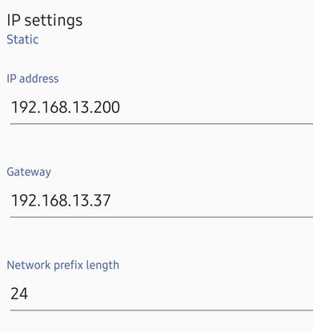
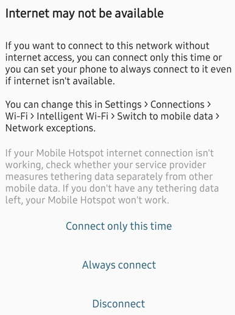

# Baby Crusty

Baby Crusty is a quadrupede robot with remote control coded in rust with the esp_hal lib, it's inspired by the sesame robot from Dorian Borian

## Features

- 8 servo motors (2 for each leg) 8 DOF
- 128x64 OLED screen that changes when the position changes
- Network connectivity, Crusty creates a WiFi network for remote control
- Webapp to control it made with JS and html/css
- 6 positions (walking, turning right, turning left, hello, freaky and rest)

## Connect your mobile to ESP32' WiFi

The esp32 doesn't run any DHCP server, so if you try to connect any device to the esp32 it won't get an IP address automatically. You will need to configure a static IP address.
So try this steps to connect to the wifi network
- When connecting your Android phone to the ESP32 Wi-Fi, select the Wi-Fi network, you can tap on “More details” (this may vary depending on your phone model), set a static IP, and then reconnect.

- On Android, you may see an error message like “Internet may not be available” In this case, select either the “Connect only this time” or “Always Connect” option. Once connected, you can access the web server by navigating to the URL.

## 3D Models
All 3D models present at the stl directory taken or modified versions of the Sesame robot repository at
https://github.com/dorianborian/sesame-robot
